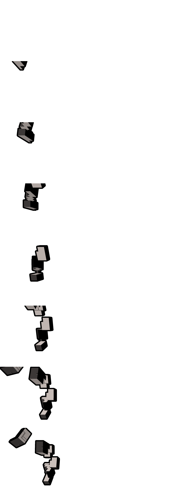

# Animated Mojang（基岩版 Android ARM64 移植版）

[](https://github.com/spygamingog)
[](https://minecraft.net)
[](https://github.com/LiteLDev/LeviLamina)
[](https://github.com/spygamingog)
[](README.md)

运行于 **LeviLaunchroid**（LeviLamina Android 版）的 **我的世界基岩版（Android ARM64）** 高性能原生 C++ 客户端模组。

由 **[SpyGamingOG](https://github.com/spygamingog)** 移植并维护。  
灵感源自 Java 版模组 [chara2015/animated_mojang](https://github.com/chara2015/animated_mojang) 以及 Windows x64 LeviLamina 移植版 [MRUIAW/Animated-Mojang](https://github.com/MRUIAW/Animated-Mojang)。

---

## 效果展示



*通过 OpenGL ES 3.0 直接渲染的 60 帧实时 3D 洞穴背景，配合硬件加速的 69 帧 Minecraft 动态标题与零延迟子菜单视角切换。*

---

## 版本兼容性

| 组件 | 支持版本 |
|---|---|
| **我的世界基岩版** | `1.26.52.3`、`1.26.45.1` 及兼容的 1.26.x 版本 |
| **运行平台** | Android ARM64 (`aarch64-linux-android`) |
| **模组加载器** | LeviLaunchroid（LeviLamina Android 客户端变体） |
| **移植维护者** | [SpyGamingOG](https://github.com/spygamingog) |
| **发布版本** | `1.0.8-mc26.52` |

---

## 核心特性

1. **实时 60 帧 3D 洞穴 GPU 渲染引擎 (`CaveGlesRenderer`)**：
   - 通过 GOT 重定位挂钩 `glClear`（RVA `0x132893d8`），在游戏 GPU 渲染线程上直接绘制真实的 `normal_cave.mesh`（98,094 个顶点）。
   - 具备预烘焙彩色光照、动态流动熔岩 UV 滚动动画、壁挂灵魂火把以及火焰/烟雾粒子特效。
   - 自然的三次样条开场运镜，主菜单静止状态具备微幅环境呼吸晃动。

2. **全屏硬件加速 69 帧 Minecraft 动态标题**：
   - 采用基岩版原生 JSON UI 的 `aseprite_flip_book` 引擎播放 69 帧动画（`animated_title.png` + `animated_title.json`）。
   - **零按钮位移布局架构**：父面板 `title_panel_pocket` 严格保持原版尺寸 `[ "55%", "18.85%x" ]`，确保所有主菜单按钮保持居中不被下推。子图像 `title_image` 缩放至 `[ "171.8%", "156.7%" ]` 并带 `-30%` 垂直偏移，使标题字母以 100% 原版大小精确坐落在“开始游戏”按钮上方，碎石与灵魂粒子自然向上飘入顶部空白区域。

3. **零延迟流畅子菜单运镜切换**：
   - 为各个菜单页面量身定制的电影级镜头视角：
     - **主界面 (Start Screen)**: `(31.0, 13.0, 6.0, yaw=21.0, pitch=-13.0)`
     - **世界列表 (Play / Worlds)**: `(28.0, 12.0, 14.0, yaw=15.0, pitch=-8.0)`
     - **设置界面 (Settings)**: `(24.0, 14.0, 25.0, yaw=30.0, pitch=-5.0)`
     - **Realms 界面**: `(33.0, 11.0, 10.0, yaw=10.0, pitch=-15.0)`
     - **商城界面 (Marketplace)**: `(20.0, 15.0, 35.0, yaw=45.0, pitch=-2.0)`
     - **更衣室 / 档案 (Dressing Room)**: `(35.0, 12.0, 5.0, yaw=5.0, pitch=-20.0)`
   - 采用原生按钮点击拦截（`0x0A31344C`、`0x0A3171AC` 等）与菜单退出挂钩（`0x0A567540`），杜绝路由预检引起的卡顿与视角拉扯。

4. **全景透明遮罩通过管线 (`AnimatedMojang_RP.mcpack`)**：
   - 替换 RenderDragon 默认全景图纹理为全透明图像，避免 RenderDragon 远古城市天空盒遮挡底层的 OpenGL ES 3D 洞穴。

---

## 安装说明

### 方式一：LeviLauncher 一键安装（推荐）
1. 从 [最新 Release](https://github.com/spygamingog/Animated-Mojang-Android/releases) 下载 **`AnimatedMojang_Suite_Android.zip`**。
2. 解压压缩包。
3. 打开 **LeviLauncher** -> **模组** 标签页 -> **导入** -> 选择 **`animated_mojang.levipack`**。
4. 在文件管理器中点击 **`AnimatedMojang_RP.mcpack`** 直接导入基岩版，或复制 `AnimatedMojang_RP` 文件夹至 `resource_packs` 目录。
5. 在游戏 **设置** -> **全局资源** 中激活 **Animated Mojang Resources**。
6. 通过 LeviLauncher 启动游戏即可体验！

### 方式二：手动文件夹安装
1. 将 `AnimatedMojang` 文件夹解压至：
   ```
   /sdcard/Android/media/org.levimc.launcher/minecraft/<配置文件名>/mods/AnimatedMojang/
   ```
2. 将 `AnimatedMojang_RP` 文件夹解压至：
   ```
   /sdcard/Android/media/org.levimc.launcher/minecraft/<配置文件名>/external/games/com.mojang/resource_packs/AnimatedMojang_RP/
   ```
3. 在 `mods_config.json` 中确保 `AnimatedMojang` 的 `"enabled": true`。

---

## 配置文件说明

编辑 `mods/AnimatedMojang/config/config.json`：

| 选项 | 默认值 | 作用说明 |
|---|---|---|
| `enabled` | `true` | 启用或禁用模组 |
| `preferJsonMainMenu` | `true` | 使用 JSON UI 动态标题（推荐） |
| `minecraftTitleAnimation` | `true` | 播放 69 帧标题动画开场 |
| `caveBackground` | `true` | 渲染实时 3D 洞穴背景 |
| `restyleLoadingProgress` | `true` | 将加载进度条重着色为绯红主题 |
| `replayOnReturnToMenu` | `false` | 返回主菜单时重新播放开场飞行 |
| `blockMenuInputDuringIntro` | `true` | 开场运镜期间屏蔽按键误触 |
| `maxPresentationSeconds` | `15` | 资源加载超时保护（5–60 秒） |

---

## 源码编译与打包

### 环境需求
- Android NDK r25+ / Clang 17+
- CMake 3.22+
- Python 3.10+

### 编译与打包命令
```bash
bash package_mod.sh
```

该脚本将自动编译 `libAnimatedMojang.so`，生成 `AnimatedMojang_RP.mcpack`，封装 `animated_mojang.levipack`，并在 `dist/` 生成开箱即用的套件包 `AnimatedMojang_Suite_Android.zip`。

---

## 致谢与版权声明

- **Android ARM64 移植与优化**：[SpyGamingOG](https://github.com/spygamingog)
- **Windows x64 LeviLamina 原作者**：[MRUIAW](https://github.com/MRUIAW/Animated-Mojang)
- **Java 版原模组作者**：[chara2015](https://github.com/chara2015/animated_mojang)
- **Minecraft**：所有游戏素材与商标属于 Mojang AB 及微软公司。
